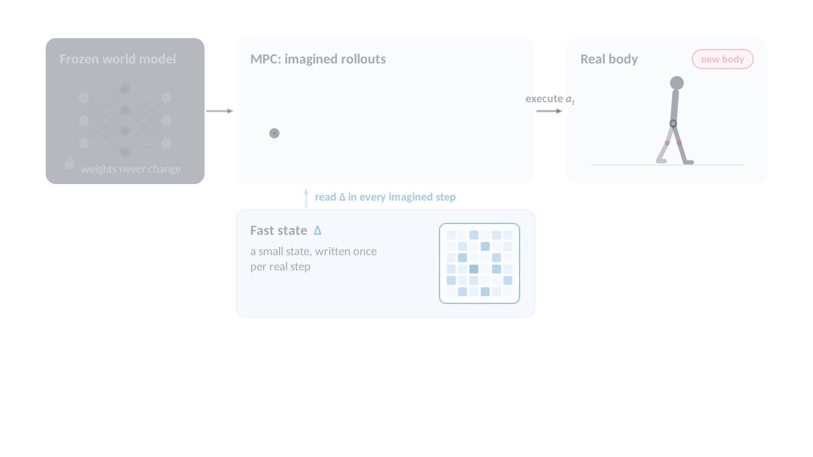

# Fast Plasticity

A frozen TD-MPC2 world model keeps its pretrained weights fixed. After each real transition, a small fast state is updated from the latent prediction error and read on the next prediction. Imagined MPC transitions read that state and do not write it. The fast state is reset at the start of every evaluation episode.




## Method Overview

https://github.com/user-attachments/assets/fb295e17-c987-478b-8079-73125f81f67d


## Overview

Keyed plasticity stores a 512×64 correction. The key is a fixed random projection of the normalized latent state and commanded action (projection seed 0, columns normalized). Bias plasticity stores one shared 512-dimensional correction in the same log-SimNorm coordinates. Both use η=0.05, λ=0.001, and a norm cap of 10. A zero fast state matches the frozen dynamics. A constant-key control uses the same update with one fixed key. `tdmpc2/baselines.py` holds the online gain estimator and known-gain correction as reference utilities. They are not methods of `scripts/evaluate.py` and do not reproduce those results.

## Installation

```bash
pip install -r requirements.txt
```

Python 3.11, PyTorch, MuJoCo, and dm_control. Versions are pinned in `requirements.txt`.

## Checkpoints

The paper uses the official state-input 5M checkpoints, seed 1 (`model_size=5`, latent dimension 512, SimNorm groups of 8):

| Task | File |
| --- | --- |
| Walker Walk | `walker-walk-1.pt` |
| Hopper Hop | `hopper-hop-1.pt` |
| Cheetah Run | `cheetah-run-1.pt` |
| Fish Swim | `fish-swim-1.pt` |
| Reacher Hard | `reacher-hard-1.pt` |

`scripts/evaluate.py` downloads them from `https://huggingface.co/nicklashansen/tdmpc2/resolve/main/dmcontrol/<file>` into `checkpoints/`. They are not committed.

## Evaluation

```bash
python scripts/evaluate.py --task walker-walk --method bias --gain 0.7 --seeds 20-39 --output results/eval.csv
python scripts/evaluate.py --task cheetah-run --method bias --gain 0.7 --seeds 20-39 --output results/eval.csv
python scripts/evaluate.py --task hopper-hop --method bias --mass 1.3 --seeds 20-39 --output results/eval.csv
```

Methods are `frozen`, `keyed`, `bias`, and `constant`. `--joint-gains` sets per-joint actuator gains. `--seeds 20-39` is the confirmation cohort. `--seeds 0-19` is the development cohort. `--checkpoint-seed` selects the pretrained file. Each episode sets `cfg.seed` to the environment seed before the task is created, then resets the fast state. Each episode uses 500 controller decisions and action repeat 2.

## Reproducing the paper

```bash
bash scripts/reproduce_results.sh
```

`results/episode_returns.csv` is a representative subset: Walker gain 0.6, Cheetah gain 0.7, Fish gain 0.7, and Hopper torso mass ×1.3, confirmation seeds 20–39, methods frozen, keyed, and bias (240 rows). It does not cover every condition in Table 1. The script rebuilds `results/summary.csv` from those rows and writes `results/paired_bias_keyed.svg`, a three-setting bar chart. That file is not the manuscript figure package. The script refuses incomplete or duplicate seed pairs.

## Citation

Sunwoo Hong (Korea Advanced Institute of Science and Technology), Chan Park (Sungkyunkwan University), and Ali Pesaranghader (LG Corporation). *Fast Plasticity Recalibrates a Frozen World Model*. 2026. No DOI or venue is assigned. See `CITATION.cff` and `CITATION.bib`.

Nicklas Hansen, Hao Su, and Xiaolong Wang. TD-MPC2: Scalable, Robust World Models for Continuous Control. arXiv:2310.16828. https://www.tdmpc2.com

## Acknowledgments

The world model, planner, environments, and checkpoints come from the TD-MPC2 implementation by Nicklas Hansen, Hao Su, and Xiaolong Wang (MIT License). See `LICENSE` and `THIRD_PARTY_NOTICES.md`.
